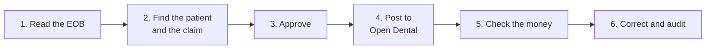

---
search:
  exclude: true
---

# How Ordo works — the codebook

The rest of this site tells you **which button to press**. This section tells you **what Ordo decides when you press it**, step by step, in the order the software actually does it. Each step includes the real cases that shaped the rule.

It is written for the people who post insurance payments every day. You know remittances better than any engineer. The point of this section is to put Ordo's rules in front of you so you can tell us where they are wrong or incomplete.

!!! info "Examples use made-up people"
    Every **real case** box describes something that happened at a real clinic with a real remittance. Names, member IDs, claim numbers, dates of birth and dollar amounts are replaced with our usual Bright Smile Dental cast (Maria the patient, Mike the reviewer, Jennifer who posts). Payer names, layouts and the situation itself are real.

---

## The six steps

| Step | Plain-language question | Page |
| --- | --- | --- |
| 1 | What does the remittance say? | [Reading the EOB](reading-the-eob.md) |
| 2 | Which chart and which claim in Open Dental is this about? | [Finding the patient and claim](finding-the-patient-and-claim.md) |
| 3–4 | What exactly gets written to Open Dental, and when does Ordo refuse? | [Approving and posting](approving-and-posting.md) |
| 5 | Did the payer pay what the contract says? | [Checking the money](checking-the-money.md) |
| 6 | What can be changed afterwards, and who sees it? | [Corrections and safety](corrections-and-safety.md) |

At the end there is a one-page [edge-case checklist](edge-case-checklist.md) to go through with your team.

---

## How each page is laid out

Every step follows the same pattern:

1. **What Ordo does** — the rule, written the way the software applies it. Numbers (points, thresholds, cents) are the real ones.
2. **Real cases** — situations a clinic actually hit, marked with an example box. **Safeguard** boxes (marked with a tip icon) describe protections for situations we expect but have not seen go wrong yet.
3. **What Ordo does not do yet** — known gaps. We would rather you read them here than discover them on a Friday afternoon.
4. **Questions for your team** — the edge cases we suspect exist but have not seen.

!!! example "What a real-case box looks like"
    **What happened.** A Cigna claim ran onto a second page, and Ordo dropped what looked like duplicate X-ray lines.

    **What Ordo does now.** Lines on a continued page are always added, never de-duplicated.

---

## Tell us what we missed

If something on these pages does not match what you see at the front desk, or a situation you handle every month is not here:

- Email **[help@perfect.ventures](mailto:help@perfect.ventures)**.
- Include the **EOB ID** from Ordo (or the payer and layout name) and one sentence on what you expected.
- Do **not** paste patient names, member IDs or dates of birth into the email. The EOB ID is enough for us to find the file.

Every confirmed edge case becomes a rule, a test that runs on every change, and a new example box on these pages.

---

[Start: 1. Reading the EOB →](reading-the-eob.md)
